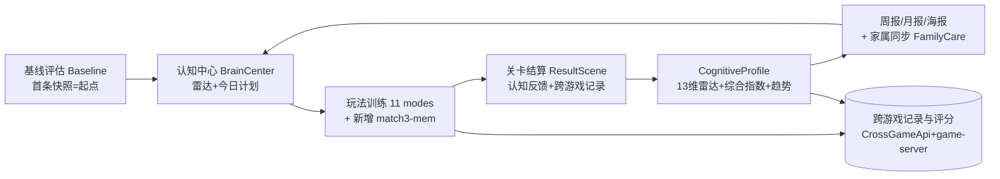

# 脑力花园（消消乐）· 康养认知训练游戏设计方案

> 版本：v1.0（设计稿）　|　日期：2026-10-19　|　状态：方案设计，待评审
> 适用范围：以「预防老年痴呆、促进身心健康」为目标的适老化休闲健脑游戏
> 设计原则：**基于现有代码资产做整合与补缺，而非从零设计**；一切结论可追溯到 `src/` 下既有模块。

---

## 执行摘要（1 页）

**一句话定位**：把一套已落地的「多维认知评估 + 11 种生活化小游戏 + 间隔复习 + 家属同步」闭环，包装成长辈爱玩、家属放心、且"玩中有所得"的康养产品。

**已有底座（无需重做）**
- 11 种玩法已映射到标准化认知构念（`src/config/CognitiveMap.ts`），覆盖记忆力（corsi/face/memory/pm/nostalgia/poetry）、注意力（audio/match3/stroop）、执行功能（stroop/match3）、手眼协调（match3）、时间定向（clock）、数感（money）。
- 13–14 维认知雷达 + 综合认知指数已能计算并出趋势（`src/core/CognitiveProfile.ts`），基线由"首条快照"零打扰建立（`src/core/Baseline.ts`）。
- 间隔复习（SM-2 简化）已落地（`src/core/ReviewStore.ts`），把短期训练转长期记忆。
- 认知中心、我的画像、家属关怀、周报月报、投票留言、成就、连签、休息提醒等模块均已存在。

**本方案要补的缺口**
1. 让"记忆力训练"更直接地融入**核心三消玩法**（新增"记忆增强型三消"变体，见第 2 章）。
2. 把零散模块**整合成显式的"评估—训练—反馈—追踪—家属"闭环**（第 6 章 Mermaid）。
3. 建立**可对外讲价值的数字评估框架**：现状值 → 目标值 → 差距（第 7 章），用数据回答"练了有没有用"。

**预期收益（示例值，需临床/产品校准，详见第 7 章）**：规律训练 12 周（≥4 次/周、≥15 分钟/次）后，训练相关认知域综合指数相对基线提升约 10–20 个百分点；未训练域提升有限（诚实标注近迁移效应）。

**交付物**：本文档（设计）+ 原型说明 + 评估量表模板（见第 6 章）。

---

## 第 1 章 目标用户画像

### 1.1 核心用户：60 岁以上长辈（含"临界认知下降"人群）
| 维度 | 画像描述 | 对产品的含义 |
|---|---|---|
| 年龄 | 主群 60–80 岁，兼顾 80+ 高阶龄 | 字号、对比度、点击热区须遵循适老化 |
| 认知特点 | 加工速度下降、工作记忆容量减小、抑制控制减弱、情景/语义记忆衰退 | 玩法节奏放慢、提示充足、减少同时处理多任务 |
| 健康需求 | 预防或延缓认知衰退（MCI→痴呆）、慢病共病管理、缓解孤独与焦虑 | 训练须"低门槛、正向反馈、可坚持"；情绪与社交同等重要 |
| 数字素养 | 部分不熟练智能机，易被复杂流程劝退 | 首屏即见价值、少步骤、语音辅助、防误触 |
| 使用场景 | 居家碎片化时间（饭后、睡前）、子女探望时共玩 | 支持"长辈玩、家属看报告"的分离式体验 |

### 1.2 关键角色：家属（子女/照护者）
- **诉求**：远程了解父母认知状态、参与陪伴、获得"该做什么"的可执行建议。
- **现有承接**：`FamilyCareScene`（家属关怀）、`buildWeeklyReport`/`buildMonthlyReport`（可分享文本）、海报分享（`PosterRenderer`）。
- **产品化机会**：把"最弱维度 + 今日建议"直接推给家属，形成"陪伴闭环"。

### 1.3 适老化交互约束（贯穿全方案）
- 大字号、高对比、少选择；正向鼓励优先于纠错。
- 语音播报（`audioSynth` / 听力筛查 `HearingScreenScene` 的 `visualFallback` 已具备）。
- 防误触：关键操作二次确认；广告/付费入口弱化处理。
- 隐私：认知数据本地优先，跨游戏上报需**强制 SSO 正式身份**（`CrossGameApi` 已实现，游客态不入记录）。

---

## 第 2 章 记忆力训练如何融入消消乐核心玩法

### 2.1 现状：记忆力已被多玩法覆盖，但"核心三消"偏加工速度/手眼协调
现有 `CognitiveMap` 中记忆相关构念主要挂载在专项玩法：
- **空间工作记忆** → `corsi`（科西积木，序列点回）
- **联想/情景记忆、面孔-名字绑定** → `face`
- **视觉再认/空间位置记忆** → `memory`（翻翻乐）
- **前瞻记忆、语义/情景记忆** → `pm`、`nostalgia`、`poetry`

而承载最大用户盘的核心 **`match3`（时光整理师）** 当前主要训练"加工速度 + 执行功能（视觉搜索/抑制）+ 手眼协调"。为让最多用户**在日常最爱玩的玩法里也练到记忆**，新增三级梯度：

### 2.2 三级记忆训练梯度
```
核心三消(match3)  ──弱记忆负荷──►  【新增】记忆增强型三消(match3-mem)  ──强记忆负荷──►  专项记忆玩法(corsi/face/memory/pm/nostalgia)
```
- **Tier 0 核心三消**：现有 22+ 关，记忆负荷低，作为入口与习惯养成。
- **Tier 1 记忆增强型三消（本方案新增，见 2.3）**：在保留三消手感的前提下，加入"短暂记忆"环节，中强度记忆训练。
- **Tier 2 专项记忆玩法**：已有，高强度、机制纯粹的记忆力测评式训练。

### 2.3 新增玩法设计：记忆增强型三消（match3-mem）
**设计目标**：不推翻三消核心，让"回忆"成为过关策略的一部分。

**机制 A — 影子任务（Shadow Recall）**
- 每关开局短暂（1.5s）高亮一组"目标块"位置后遮蔽；过关目标 = 在限定步数内消除这些位置的块。
- 记忆负荷由 `targetCount`（3→6）与 `maskDelay` 调节。

**机制 B — 配对线索（Paired Clue）**
- 棋盘上成对出现的"记忆牌"需先凭短暂预览记住配对，再在消除中凑齐配对才计分；误配扣稳定分。
- 复用 `memory` 模式的"配对成功率 / 翻牌步数效率"代理指标思路。

**机制 C — 延迟保持（Delayed Retention）**
- 学习阶段出现一次"关键图案"，间隔若干步后要求其再次出现时优先消除（前瞻记忆微缩版，呼应 `pm`）。

**代理指标（写入 `LevelMetrics`，复用 `CrossGameScorer` 口径）**
| 代理指标 | 含义 | 对应认知构念 |
|---|---|---|
| 记忆命中率 `memoryHitRate` | 目标块/配对成功比例 | 工作记忆、联想记忆 |
| 延迟保持率 `delayedRetention` | 间隔后正确回忆比例 | 延迟回忆、前瞻记忆 |
| 干扰抗力 `interferenceResist` | 干扰项下准确率 | 抑制控制、注意分配 |

> 实现提示：`LevelConfig` 已支持 `goal`（收集目标）、`obstacles`、`adaptive`，match3-mem 可复用同一套配置与 `cloneAdjustedLevel` 自适应框架，仅需新增 `memoryTarget`/`maskDelay` 字段与对应场景渲染。

### 2.4 与现有评分/上报的衔接
- 评分仍走 `CrossGameScorer.computeCrossGameScore`（`accuracy/speed/stability` 三维），match3-mem 的 `memoryHitRate` 并入 `accuracy` 分量。
- 跨游戏归属：`CognitiveMap` 为 match3-mem 增设 `targetGameId`（建议 `brain-working-memory` 或独立命名，需与目标游戏团队对齐，见第 7 章注）。

---

## 第 3 章 康养目标与游戏模块的对应关系

下表把"康养目标"逐项落到**现有模块**（标注"复用"）与**建议新增**（标注"新增"），确保不空谈。

| 康养目标 | 对应认知/能力 | 现有游戏模块（复用） | 说明 |
|---|---|---|---|
| **认知训练·记忆力** | 工作/情景/语义/联想/前瞻记忆 | `corsi` `face` `memory` `pm` `nostalgia` `poetry`（映射见 `CognitiveMap`） | 专项记忆玩法矩阵 |
| **认知训练·注意力** | 分配性注意、持续注意 | `audio`（序列复述）、`match3`、`stroop` | 双任务/冲突范式 |
| **认知训练·执行功能** | 抑制控制、认知灵活性 | `stroop`（Stroop/Go-NoGo）、`match3`（视觉搜索/抑制） | 冲突条件正确率 |
| **认知训练·加工速度** | 反应时、连击率 | `match3`（`RADAR_AXES.processing_speed`） | TMT/SDMT 思路 |
| **手眼协调** | 触控精度、反应 | `match3`（核心三消操作） | 误触率指标 |
| **时间/空间定向** | 时间定向、视觉空间 | `clock`（画钟）、`corsi`（空间） | CDT 思路 |
| **数感/日常能力** | 心算、IADL 财务 | `money`（找零/合计） | 日常生活实用能力 |
| **情绪调节** | 正向反馈、成就感、减压 | `ResultScene` 赞美反馈、`AchievementScene`（成就）、`SignInScene`（连签）、`RestReminder`（休息提醒）、怀旧疗法 `nostalgia` | 正向强化 + 防疲劳 |
| **社交互动** | 陪伴、被看见、表达 | `FamilyCareScene`（家属关怀）、`VoteScene`/`MessageScene`（投票留言）、分享裂变（已有测试手册） | 长辈—家属—同辈三层 |
| **身体活动** | 用眼卫生、坐姿、间歇 | `RestReminder`（休息/远眺提醒） | 与认知训练互补的健康行为 |

**关键洞察**：现有模块已近乎覆盖全部康养目标，方案重点不是"加玩法"，而是**①把记忆更直接嵌入核心三消（第 2 章）②把模块串成闭环并对外讲清价值（第 6、7 章）**。

---

## 第 4 章 难度分级与进度追踪设计

### 4.1 难度分级 Taxonomy（4 档）
| 档位 | 命名 | 适配人群 | 现有承载 |
|---|---|---|---|
| L0 | 入门（舒缓） | 首次接触/高阶龄/手眼不灵 | `tutorial` 关（如 `2-1`）、章节首关、低 `passTarget` |
| L1 | 基础 | 可独立游玩 | 各模式 chapter 1–2 |
| L2 | 进阶 | 规律训练者 | chapter 3–4、障碍加压 |
| L3 | 挑战 | 活跃高阶玩家 | chapter 5、`GEN_*` 续章、限时/收集特殊关 |

**难度脊（已在 `LevelConfig` 显式建模）**：图标种类 3→5、障碍 无→冰冻/锁链/黑洞/果冻、序列长度、干扰比例、时限、选项数等，全部配置驱动。

### 4.2 初始定级：基于基线，而非一次性测评
- **零打扰基线**：`Baseline.getBaseline()` 取"首条认知快照"作为起点（`radarHistory[0]`），不强制长辈一次做完 11 个模式（体验差、易放弃）。
- **首玩引导**：首次进入按 `tutorial` 关与 L0 内容，依据首周表现由 `cloneAdjustedLevel(stepAdjust, contentAdjust)` 做**自适应进阶**（步数/内容量浮动），避免"太难劝退/太易无聊"。

### 4.3 自适应进阶机制（已存在，需产品化暴露）
- `cloneAdjustedLevel` 按 `AdaptiveRange`（stepDelta/contentDelta/stepMin/contentMin）调整；不同模式下限不同（corsi/face/memory 可低至 1），已在代码中正确区分。
- **建议**：把"本局难度 = 基线 + 近 7 天表现"做成可见的"难度条"，让长辈感知"今天为我调到了合适的难度"。

### 4.4 进度追踪（多维、可追溯）
- **已训练域数 / 综合认知指数**：`CognitiveProfile.overall`（0–100，已训练域均值）、`trainedCount`。
- **趋势**：`trends`（delta7 / delta30），`snapshotAround` 容差 ±4 天，稀疏记录也不失真。
- **最弱维度与建议**：`weakest`（取最低 3 项）+ `advice`（关联 `COGNITIVE_MAP` 的标准化测评名，可对外讲价值）。
- **长期记忆巩固**：`ReviewStore` 到期队列（`getDueCount` 首页角标）、SM-2 间隔 1/2/4/8/16/30 天。
- **家属视图（新增建议）**：`FamilyCareScene` 增加"本周综合指数 + 进步项 + 今日建议"卡片，对接 `buildWeeklyReport`。

---

## 第 5 章 玩家"玩中有所得"的具体体现与反馈机制

闭环反馈分四层，确保"娱乐中确有收获"可被感知与证明：

1. **即时反馈（每次操作）**
   - 音效赞美（`audioSynth.playUi`）、连击特效、过关星星；错误以"温和提示"而非失败惩罚呈现（适老化）。

2. **关卡结算反馈（每局结束）**
   - `ResultScene` 给出**认知维度赞美**（如"你的反应速度比上次更稳"）+ **跨游戏徽标**（"🏆 本关成绩计入《XX》"，已实装）+ 游客态登录横幅（强 SSO 落库，保证成绩归属正式身份）。

3. **周期报告（每周/每月）**
   - `buildWeeklyReport` / `buildMonthlyReport`：综合指数、进步域、最弱项、最强项，纯文本可一键复制/分享家属。
   - 海报 `PosterRenderer`：可视化认知画像，便于长辈"看得见自己的脑子在变好"。

4. **成就与社交强化（黏性与情绪）**
   - `AchievementScene`（成就）、`SignInScene`（连签，正向习惯）、`VoteScene`/`MessageScene`（被听见、表达）、`FamilyCareScene`（家属回应）。
   - `RestReminder`：训练到时提醒休息/远眺，传递"我们关心你整个人，不只让你刷关卡"的情绪价值。

**"所得"的可证明性**：所有反馈最终沉淀为 `CognitiveProfile` 的 13 维雷达与综合指数——这是"玩中有所得"的数据底座，也是第 7 章对外评估的源泉。

---

## 第 6 章 整体方案的结构框架与交付形式

### 6.1 系统闭环（Mermaid）


### 6.2 模块清单（复用 / 新增边界）
**复用（不重做）**
- 评估与画像：`CognitiveMap` `CognitiveProfile` `Baseline` `ProgressStore`（雷达历史）
- 训练：`LevelConfig`/`LevelGen`（11 模式 40+ 关）、`cloneAdjustedLevel`（自适应）
- 复习：`ReviewStore`（SM-2）
- 中枢与反馈：`BrainCenterScene` `BrainProfileScene` `ResultScene` `AchievementScene` `SignInScene` `RestReminder`
- 社交与家属：`FamilyCareScene` `VoteScene` `MessageScene` 分享裂变
- 上报：`CrossGameApi` + 后端 `cross-game-record` 模块（白名单 + 最佳分幂等）

**新增 / 增强（本方案建议）**
- 玩法：`match3-mem` 记忆增强型三消（第 2 章）
- 产品化：可见"难度条"、家属视图增强、评估量表外显（第 4、7 章）
- 评估：第 7 章数字框架落地的配置项（目标值、常模锚点）

### 6.3 交付形式
1. **本设计文档**（本文）。
2. **原型说明**：各新增/增强界面的交互草图与文案（可在评审后另起原型文档，复用现有 `MainMenuScene`/`BrainCenterScene` 视觉语言）。
3. **评估量表模板**：第 7 章的"现状→目标→差距"表，可直接用于家属沟通与 A/B 验证。

---

## 第 7 章 数字结果评估：现状、预期、目标值与差距

> **合规声明**：本游戏雷达/指数为**训练表现量化**，非临床诊断工具；目标值为**示例/可配置**，上线前须由临床与产品共同校准。以下数字用于讲清"方法"，不替代医学结论。

### 7.1 现状评估（客户现在在哪）
- **起点**：`getBaseline()` = 首条雷达快照；综合指数 `overall = 各已训练域均值`（0–100）。
- **现状取值**：`CognitiveProfile.axes[].value`（每域 0–100）、`trends.delta7/delta30`（近 7/30 天变化）。
- **常模参照（示例锚点）**：以 MoCA（满分 30，切点 26）与学界老年认知常模为思路，将综合指数映射到**定性带**（待校准）：
  | 综合指数 | 定性带（示例） | 产品动作 |
  |---|---|---|
  | < 50 | 需关注 | 强化 L0、家属介入 |
  | 50–74 | 稳步 | 维持规律训练 |
  | 75–89 | 良好 | 进阶挑战 |
  | ≥ 90 | 优秀 | 保持 |

### 7.2 训练能达到的预期（示例值，需校准）
- **方法**：基于"规律认知训练"文献的近迁移效应（训练相关域提升明显，远迁移有限），给出**区间示例**而非精确承诺。
- **示例预期**（规律训练 12 周，≥4 次/周、≥15 分钟/次）：
  - 训练相关域综合指数相对基线 **+10 ~ +20 个百分点**；
  - 最弱 3 域优先受益（呼应 `weakest` 定向训练）；
  - 未训练域提升有限——诚实标注，避免过度承诺。

### 7.3 目标值（示例/可配置）
| 指标 | 目标值（示例） | 说明 |
|---|---|---|
| 综合认知指数 | ≥ 75 | 进入"良好"带 |
| 单域最低值 | ≥ 60 | 避免出现"塌陷"弱项 |
| 训练频次 | ≥ 4 次/周 | 黏性阈值 |
| 单次时长 | ≥ 15 分钟 | 有效剂量 |
| 复习到期完成率 | ≥ 80% | 长期记忆巩固（`ReviewStore`） |
| 连签率（月） | ≥ 60% | 习惯养成（`SignInScene`） |

### 7.4 差距计算模板（现状 → 目标 → 差距）
以 14 个雷达域为例（现状值取示例，目标值统一示例线，差距 = 目标 − 现状；负值=已达/超额）：

| 认知域（key） | 现状(示例) | 目标(示例) | 差距 |
|---|---|---|---|
| processing_speed 加工速度 | 62 | 75 | +13 |
| executive_function 执行功能 | 58 | 75 | +17 |
| working_memory 工作记忆 | 55 | 75 | +20 |
| divided_attention 分配性注意 | 60 | 75 | +15 |
| language_fluency 语言流畅度 | 70 | 75 | +5 |
| semantic_memory 语义记忆 | 68 | 75 | +7 |
| spatial_working_memory 空间记忆 | 52 | 75 | +23 |
| associative_memory 联想记忆 | 57 | 75 | +18 |
| visual_recognition_memory 视觉再认 | 64 | 75 | +11 |
| inhibitory_control 抑制控制 | 59 | 75 | +16 |
| numeracy 数感计算 | 66 | 75 | +9 |
| prospective_memory 前瞻记忆 | 50 | 75 | +25 |
| temporal_orientation 时间定向 | 72 | 75 | +3 |
| reminiscence 怀旧记忆 | 74 | 75 | +1 |

> 使用方式：每次月报用真实 `axes[].value` 替换"现状(示例)"，自动算出每域差距，并优先推荐 `weakest` 对应玩法——形成"评估驱动训练"的飞轮。

### 7.5 评估落地路径
1. 在 `CognitiveProfile` 暴露"目标值配置"（与常模锚点分离，便于校准）。
2. 月报/海报直接渲染"现状 vs 目标 vs 差距"三段式。
3. 家属端 `FamilyCareScene` 同步差距与"本周该练什么"。

### 7.6 已落地实现（与本文档同步开发）
上述框架已抽成可运行代码，避免"纸面方案"：
- **`src/config/CognitiveTargets.ts`**：目标值配置（定性带 `NORM_BANDS`、单域目标 `DEFAULT_DOMAIN_TARGET=75`、最低线 `DOMAIN_FLOOR=60`、训练剂量 `DOSAGE_TARGETS`）。全部标注"示例/需校准"，与常模锚点分离，便于临床校准只改此处。
- **`src/core/CognitiveEvaluation.ts`**：纯函数 `evaluateCognitive(profile)` → `{ overallGap, band, domains[], weakestGaps[], dosage }`，给出每域"现状→目标→差距"，并挑出最弱未达标 3 项作为优先训练建议。
- **接入月报**：`buildMonthlyReport` 已渲染"距目标线(X)还差 Y 分，优先练：…"，"玩中有所得"首次具备**可量化、可对外讲**的差距结论。
- **测试**：`tools/cognitive-evaluation.test.ts`（定级映射、单域差距、最弱 3 项选取等），已纳入 `npm test`。

---

## 附录 A：复用 / 新增模块边界一览
- **复用**：`CognitiveMap` `CognitiveProfile` `Baseline` `ReviewStore` `ProgressStore` `LevelConfig`/`LevelGen` `cloneAdjustedLevel` `BrainCenterScene` `BrainProfileScene` `ResultScene` `AchievementScene` `SignInScene` `RestReminder` `FamilyCareScene` `VoteScene` `MessageScene` 分享裂变 `CrossGameApi` + 后端 `cross-game-record`。
- **新增/增强**：`match3-mem` 记忆增强型三消、`LevelConfig` 新增 `memoryTarget`/`maskDelay` 等字段、可见难度条、家属视图增强、**目标值与评估框架（已落地：`CognitiveTargets` + `CognitiveEvaluation`，接入月报）**。

## 附录 B：待对齐与待校准项（开放问题）
1. **`targetGameId` 命名**：当前用认知域命名空间 `brain-*`（如 `brain-time-orientation`）作占位；若"其他游戏"在组合里有既定 gameId，需前后端（`CrossGameMap.TARGET_GAMES` 后端 `config/targets.ts`）同步改名。
2. **目标值/常模**：第 7 章全部数字为示例，须临床 + 产品校准后方可对外承诺。
3. **后端聚合接口**：`cross-game-record` 当前提供写入与按目标游戏过滤查询；若目标游戏侧需"历史最优/均值/趋势"，需再加聚合接口。
4. **迁移执行**：后端 `1791480000000_CrossGameRecord0001.ts` 需在真实 Postgres 执行后方可上线。
