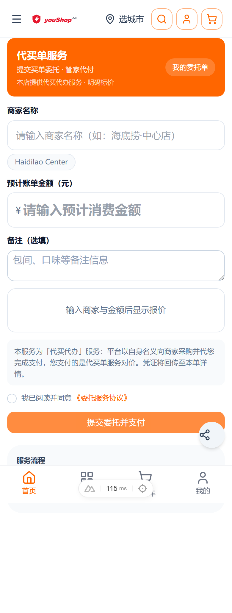
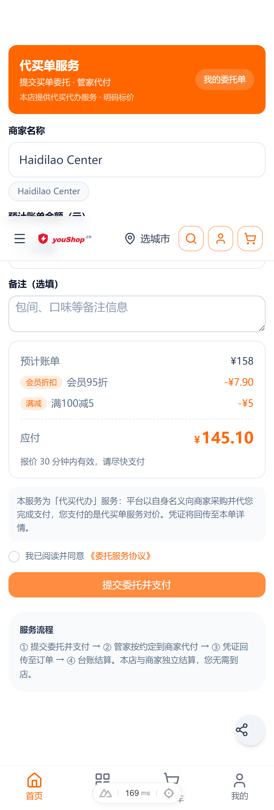
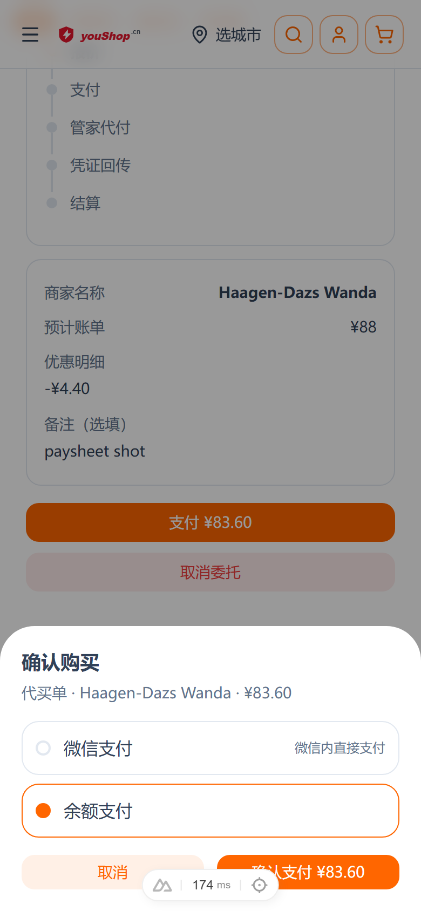
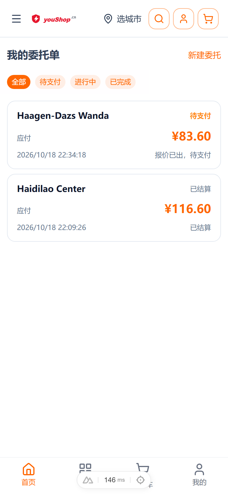
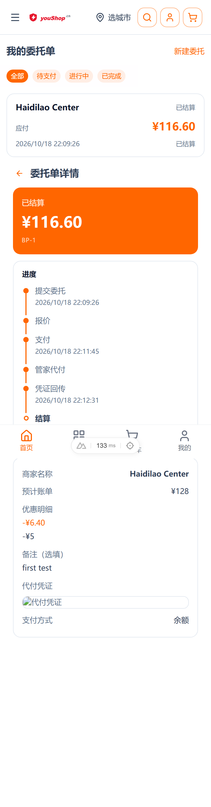
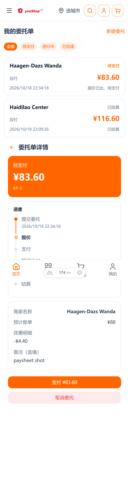
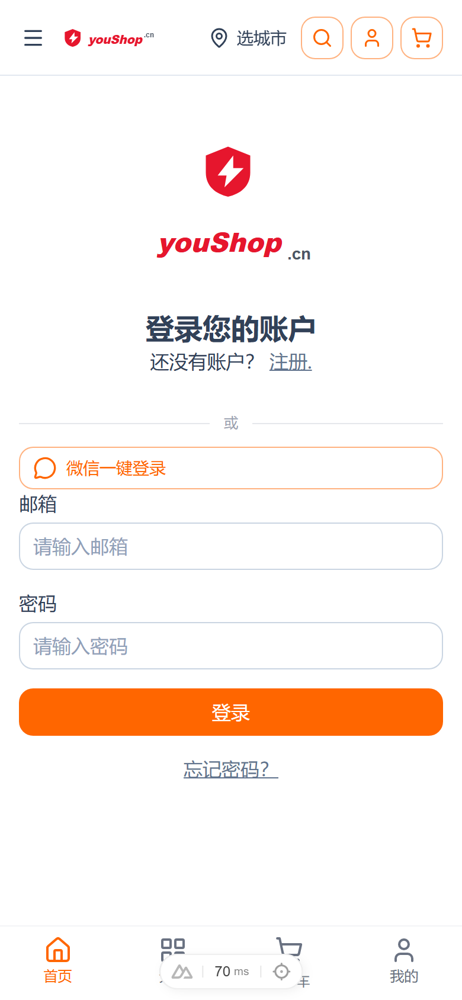
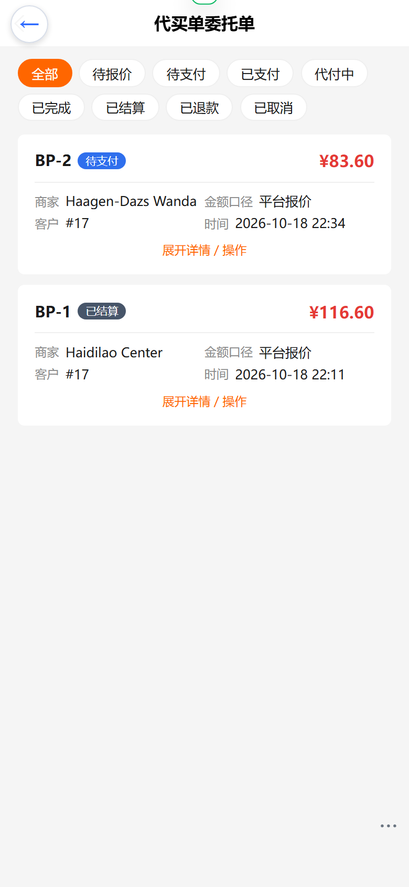
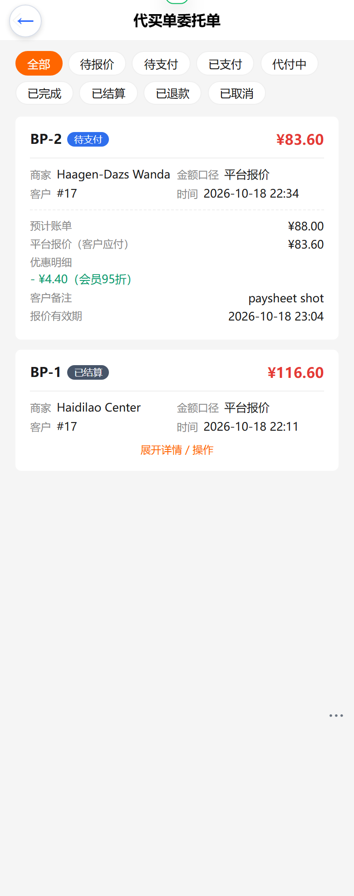
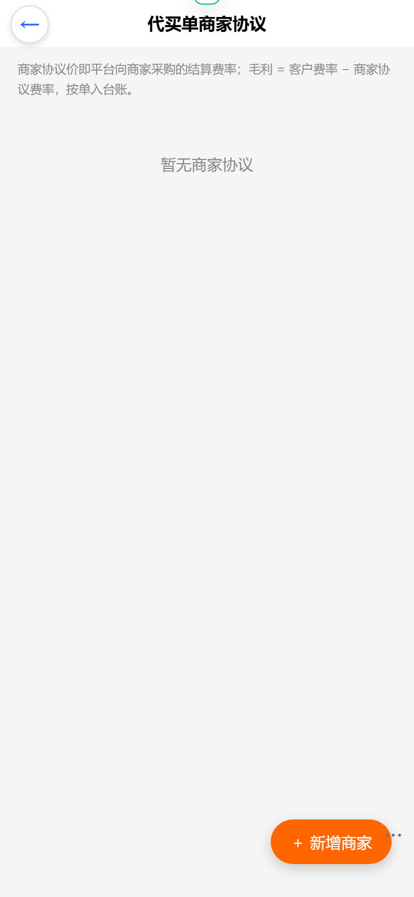

# t3 代买单（委托单模式）操作手册

> 交付日期：2026-10-18 ｜ 视口规范：390×844 dpr=2 ｜ 截图目录：`nshop/docs/manual/shots/2026-10-18-billpay-t3/`

## 1. 业务概述

「代买单」是平台代客向商家采购的服务：客户提交委托（商家 + 预计账单）→ 平台算账报价（会员折扣 + 满减，明码标价）→ 客户支付报价 → 管家接单代付 → 凭证回传 → 差价结算入台账。平台毛利 = 客户支付 − 实际代付（差价模型）。

适用渠道：`storefrontMode = billpay` 的 t3 服务店（nshop 前端整店切换为代买单形态）。

## 2. C 端流程（nshop /t3/）

### 2.1 首页提交委托

首页即代买单提交表单：商家名称（带历史联想）、预计账单金额、备注（选填）。

输入金额后**实时报价**（免提交试算）：下方报价卡展示预计账单、会员折扣、满减明细与应付金额（30 分钟有效）。

> 示例：预计 ¥158 → 会员95折 −¥7.90 → 满100减5 −¥5 → 应付 ¥145.10

### 2.2 支付报价

勾选《委托服务协议》→「提交委托并支付」→ 支付弹层（微信支付 / 余额支付二选一）→ 确认支付。

### 2.3 我的委托单

列表按 全部 / 待支付 / 进行中 / 已完成 四类过滤；卡片展示商家、应付金额、状态、时间。

详情页含**状态时间线**（提交委托 → 报价 → 支付 → 商家代付 → 凭证回传 → 结算）、优惠明细、支付方式与代付凭证。

待支付单详情底部有「支付 ¥xx」与「取消委托」操作：

未登录访问委托单页自动引导登录：

## 3. B 端工作台（web-admin，权限 BillPayManage）

### 3.1 委托单工作台

菜单：代买单 → 代买单委托单。状态 chips 全量筛选（待报价/待支付/已支付/代付中/已完成/已结算/已退款/已取消）。

「展开详情 / 操作」看预计账单、平台报价、优惠明细、报价有效期等（QUOTED 态无 B 端操作，等客户支付）：

各状态操作：

| 状态 | 操作 | 说明 |
| --- | --- | --- |
| 待报价 PENDING_QUOTE | 报价（金额+说明必填） | autoQuote 关闭或试算失败时人工报价 |
| 已支付 PAID | 接单 / 人工退款 | 接单后取消/退款仅走人工 |
| 代付中 IN_SERVICE | 凭证回传完成代付 | 实际金额超报价 ±10% 须填说明 |
| 已完成 COMPLETED | 标记结算 | 写商户结算台账（差价毛利入账） |

### 3.2 商家协议

菜单：代买单 → 代买单商家协议。维护商家协议结算费率（85 = 8.5 折）与结算方式（现付单结 / 月结记录口径）。

## 4. 渠道配置（t3 上线 checklist）

> **✅ 已于 2026-10-18 生产落地**（实际情况与原计划差异见下）。

1. ~~创建渠道（code `t3`）~~ → **实际复用既有 t3 渠道**（id=38，tenantNo=23）：生产 `t3` 已被「陈记烘焙馆·手机版」占用，经用户确认原地改造——`updateTenant` 更名「代买单服务店」+ `storefrontMode=billpay`（domain www.youshop.cn/t3、industryType=retail 保持不变）
2. 确认 `__customer_role__` 客户角色已关联该渠道（2026-10-18 全量补齐 28 渠道，无需操作）
3. 写入 `bill_pay_config`（channelId=38）：autoQuote=true / quoteExpireMinutes=30 / tolerancePercent=10 / minAmount=2000 / maxAmount=200000 / dailyLimitAmount=200000 / memberDiscount=95 折 / thresholds 满100减5（幂等 ON CONFLICT，服务器 node+pg 直插）
4. nshop 侧无需发版：租户注册表动态发现，`/t3/` 路由即生效（SSR 200，正文已渲染代买单版式）

**上线时踩坑记录（重要）**：M1-M6 只改了 `dev-config.ts` 注册 BillPayPlugin，**未重建 `dev-server/dist`**——线上 schema 长时间缺失全部 billpay 字段。修复 = 本地 `tsc -p tsconfig.prod.json` 重建 dist 提交（vendure `22c8bf6eb`）。以后凡动 dev-config.ts 必须重建 dev-server dist 并提交。另：服务器 `node_modules/@vendure/bill-pay-plugin` symlink 需手工补建（新插件必查）；billpay 表自动建（synchronize），列名为**驼峰**（channelId/config，无 snake 策略）。

## 5. 本地联调要点（复现记录）

- vendure dev-server 已注册 BillPayPlugin；本地建 t3 渠道 + seed `bill_pay_config` 后全流程可跑
- nshop 本地：`GQL_HOST=http://127.0.0.1:3000/shop-api`、`CHANNEL_TOKEN=<本地默认渠道token>`、`DEV_PROXY_TARGET=http://127.0.0.1:3000/shop-api`
- 手机验证码 devBypass：123456（DEV_BYPASS_SMS）
- 验证数据：BP-1（Haidilao Center，¥128 → 报价 ¥116.60，余额支付 → 接单 → 凭证 ¥115 → 结算，毛利 ¥1.60 入台账）；BP-2（Haagen-Dazs Wanda，¥88 → 报价 ¥83.60 待支付）
- 已知修复：`pages/billpay/orders.vue` 需含 `<NuxtPage/>` 出口（与 `orders/[id].vue` 构成父子路由）
