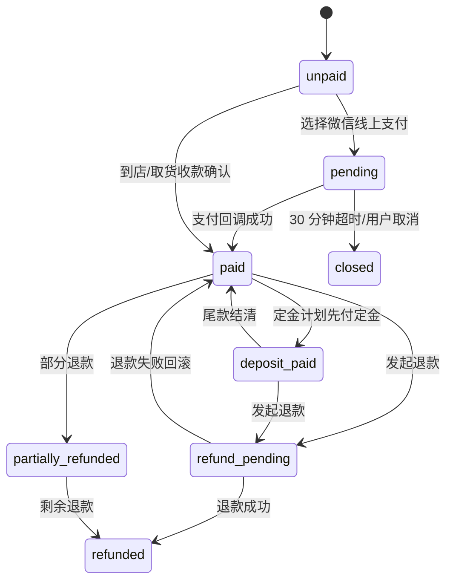
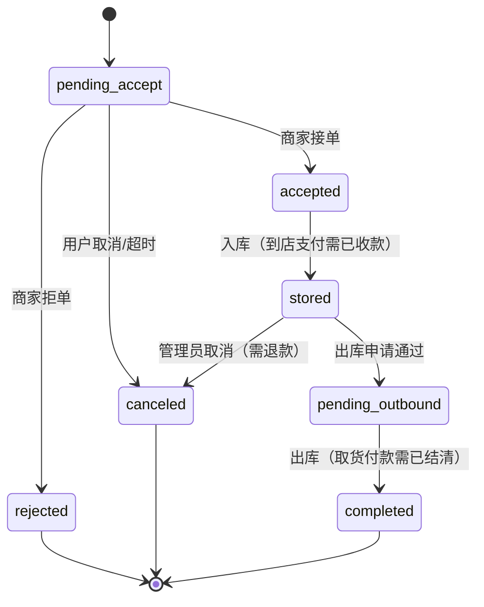

# 轮胎寄存 v2：支付方式与分享裂变 PRD（草案）

> 版本：v0.1（勘察 + 方案 + Mockup，待确认）
> 日期：2026-11-04
> 范围：C 端 H5（`d:\zhao\tai`）+ 运营端（Strapi `zhao-tire` 插件）
> 状态：**未改生产代码**；本文仅为方案评审稿

---

## 0. 结论摘要

1. **支付现状是"记账"不是"支付"**：H5 下单固定写 `store_pay`，订单详情只展示支付方式/支付状态；唯一到账方式是运营端手工 `POST /orders/:id/payment` 登记，没有支付流水、没有微信支付、没有退款接口、出库完成也不校验是否已付款。
2. **三种方式建议拆成"渠道 × 时点"两个维度**，而不是继续塞进现有 `paymentMethod` 枚举。现枚举把 `store_pay`（渠道/时点混合）、`deposit`（金额计划）、`full`（金额计划）混在一个字段，直接扩展会产生脏数据。
3. **微信线上支付硬前提目前不满足**：服务器环境没有 `WECHAT_APPID` / `MCHID` / APIv3 key / 商户证书；`tire.joho.cn` DNS 不存在；`www.joho.cn` 已有 HTTPS，可作为候选回调域名（需在商户平台配置并确认备案主体）。没有商户资质就无法真联调，只能先做沙箱外的"假支付"联调桩。
4. **分享裂变目前只有结果计数，没有分享行为数据**：`tire-referral-code` 有 `usedCount/completedCount/pendingFreeCount/totalFreeCount`，但下单流程并未调用 `attachReferral()`，`usedCount` 实际不会增长；`markCompleted()` 只在运营端手工登记支付且首次变为 `paid` 时触发，所以"邀请 3 人"在真实业务里大概率永远不达成。需要新增分享记录/奖励实体并修结算时点。
5. **推荐"满三人免费"口径**：仅统计**新用户的首笔订单完成入库**为有效邀请；每 3 个有效邀请发 1 次**基础套餐费免单**（不含增值服务/逾期费），有效期 12 个月、每年上限 4 次；退款/取消/风控命中则回滚。永久免费和高比例全额免单不建议。
6. **必须先补的业务底座**：支付流水与对账、取货核销码、退款政策、到期提醒与逾期费、轮胎编号/照片绑定。否则支付方式一上线，钱和货都对不上。

---

## 1. 现状勘察（证据）

### 1.1 H5 现有支付相关代码

| 项目 | 现状 | 证据 |
|---|---|---|
| 支付方式选择 | **不存在**。创建订单页没有支付方式 UI，提交 payload 不含 `paymentMethod` | `src/pages/order/create.vue`（`submit()` 组装 payload，仅含业务字段；无 `paymentMethod`） |
| 下单默认支付方式 | 后端固定 `paymentMethod: "store_pay"`，`paymentStatus: "unpaid"` | `plugins/zhao-tire/server/src/services/order.ts:476-478` |
| 支付状态展示 | 订单详情展示 `paymentStatus` / `paymentMethod` / `paidAmount`，仅只读 | `src/pages/order/detail.vue:146-156` |
| 线上支付开关 | 配置里有 `paymentOnlineEnabled`、`depositEnabled`、`depositRatio`，但 H5 **从未读取**（仅类型声明） | `src/api/site.ts:29-31`；`tire-config/schema.json:68-79` |
| 免单订单 | 创建时直接把 `amountPackage/amountAddon/amountTotal` 置 0，`paymentStatus` 置 `paid`、`paidAmount=0`、`paymentMethod=full` | `order.ts:398-408,473-478` |
| 续存 | `renew()` 记录续存月份/金额，但不改订单 `amountTotal`、不新增支付流水、不区分是否已付 | `order.ts:619-645` |
| 取货流程 | 用户提出出库申请 → 运营审核 `approveOutbound` → 仓管上传出库照片 `outbound` 直接完成；**全程不校验付款** | `order.ts:804-836,843-868` |
| 取货凭证 | 无核销码、无扫码交接；仅订单号+手机号查询 | `src/pages/order/detail.vue` 出库区仅备注+提交 |

### 1.2 订单状态机与金额字段

- 订单状态：`pending_accept` → `accepted` → `stored` → `pending_outbound` → `completed`；另有 `rejected` / `canceled`。
- 出库申请状态：`none` / `pending` / `approved` / `rejected`。
- 金额字段全部按**分**存储：`amountPackage`、`amountAddon`、`amountTotal`、`paidAmount`。
- 现有支付枚举：`paymentMethod = store_pay | deposit | full`，`paymentStatus = unpaid | deposit_paid | paid`。
  - 问题：`deposit/full` 是"付多少"，不是"怎么付"；未来加"微信/取货付款"必须拆维度。

### 1.3 Strapi 侧模型与路由

内容类型（`plugins/zhao-tire/server/src/content-types/`）：

`tire-order`、`tire-config`、`tire-package`、`tire-addon`、`tire-referral-code`、`tire-sms-log`、`tire-faq`、`tire-gallery`、`tire-review`。

**没有支付流水表**，也没有退款表；支付只是订单上的三个字段。

对外路由（`content-api.ts`）中 **没有支付回调路由**；运营端路由：

- `POST /orders/:id/payment` → 权限 `full`（`routes/admin-api.ts:51`）
- `GET/PATCH /referral-codes...`、`POST /referral-codes/:id/grant-free` → `full`（`admin-api.ts:137-139`）
- `GET/PATCH /sms-logs` → `full`（`admin-api.ts:142-143`）

手工登记支付逻辑（`order.ts:1001-1041`）：累加 `paidAmount`，达到 `amountTotal` 置 `paid`；首次 `paid` 且订单有邀请码时调用 `referral.markCompleted()`。**没有幂等键、没有流水号、没有退款/撤销、没有金额上限校验。**

### 1.4 短信

- 默认 provider = `queue`（`sms-provider.ts:28-37`），即只写 `tire-sms-log` 待发队列，管理员人工标记发送。
- 阿里云短信需 `ALIYUN_SMS_ACCESS_KEY_ID/SECRET/SIGN_NAME/TEMPLATE_CODE` 四项齐全，否则降级队列（`sms-provider.ts:51-55`）。
- 服务器 `.env` 实测**不存在** `SMS_PROVIDER`、`ALIYUN_SMS_*`。
- 影响：支付成功、退款到账、待取货、到期提醒都**不会自动送达**；只能靠 H5 轮询/用户主动查单。支付回调本身不依赖短信，但"支付后体验"和"取货通知"会缺失。

### 1.5 OSS 与照片

- 服务器 `.env` 存在 `ALIYUN_OSS_*` 配置项，但业务反馈 OSS provider 初始化失败，照片落 `public/uploads`（本地磁盘）。
- 影响：
  - 支付凭证/退款凭证若也走本地上传，无法生成稳定的外链、无法做私有读签名、迁移/扩容会丢图；
  - 分享海报若依赖服务端合成图片，本地目录不适合做 CDN 缓存与微信域名校验；
  - `public/uploads` 与代码目录同机，发版/回滚有误删风险。
- 结论：支付凭证与分享海报**不应依赖当前本地上传**；海报优先客户端 Canvas 生成，凭证后续接私有 OSS bucket。

### 1.6 运营端权限

`bootstrap.ts` 中：

- `tire-admin`：插件全权限。
- `tire-warehouse`：仅 `order.find/findOne`、`order.inbound`、`order.outbound`、`upload`。

缺口：

| 能力 | 现状 | 风险 |
|---|---|---|
| 线下收款确认 | 只有 `full` 权限可调 payment 接口 | 仓管/前台无法确认到账，只能找管理员 |
| 退款 | 无接口、无权限 | 无法线上退款，也无法记录线下退款 |
| 支付流水查看/导出 | 无表、无权限 | 无法对账 |
| 分享审核/反作弊 | 无表、无权限 | 无法处理刷单 |
| 取货核销 | 无核销码/扫码接口 | 无法证明"胎已交给正确的人" |
| 审计 | 仅 timeline 文本 | 谁确认、谁退款无法追责 |

### 1.7 微信支付硬前提实测

| 前置项 | 现状 | 是否阻断 |
|---|---|---|
| 商户号 `mchid` | 服务器环境无 `WECHAT_MCHID` / `MCH_ID` | 阻断 |
| 公众号/小程序 `appid` 与商户号绑定 | 无 `WECHAT_APPID`；仅有 `WECHAT_REDIRECT_URI` | 阻断 |
| APIv3 密钥（32 位） | 无 | 阻断 |
| 商户 API 证书（apiclient_key.pem / serial） | 无 | 阻断 |
| 微信支付平台证书/公钥（验签） | 无 | 阻断 |
| 回调域名 HTTPS + 443 + 公网可达 | `www.joho.cn` 已有 HTTPS 且接口可达；`tire.joho.cn` DNS 不存在 | `tire.joho.cn` 阻断；`www.joho.cn` 可候选 |
| 回调域名为备案主体名下 | 需商户平台确认 | 待确认 |
| JSAPI 支付需 openid | 无微信网页授权链路 | 阻断（若走 JSAPI） |
| H5 支付需商户开通 H5 支付 + 场景域名 | 未开通 | 阻断（若走 H5 支付） |

> 结论：**没有商户资质与密钥，真实微信支付无法联调。** 可先完成"支付单 + 回调 + 对账"的代码骨架与本地假网关（`PAY_PROVIDER=mock`），待资质到位再接真实 APIv3。

---

## 2. 目标与非目标

### 2.1 目标

1. 支持三种支付方式：微信线上支付（预付）、到店支付（线下收银）、取货时付款（后付）。
2. 建立统一支付流水与退款流水，所有到账/退款可追溯、可对账。
3. 分享裂变可统计：分享人数、有效邀请、转化率、免单发放/使用/回滚。
4. 运营端可按角色确认到账、发起退款、查看分享报表。

### 2.2 非目标（本轮不做）

- 不做分期、花呗、组合支付、多商户分账。
- 不做发票系统（仅预留字段与入口）。
- 不重构 Strapi 订单主流程以外模块。
- 不迁移到 Vendure 运行时。

---

## 3. 支付方案设计

### 3.1 先拆维度：渠道 / 时点 / 金额计划

| 维度 | 字段 | 取值 | 说明 |
|---|---|---|---|
| 支付渠道 | `paymentChannel` | `wechat_online` / `store` / `pickup` | 钱在哪里、怎么收 |
| 支付时点 | `paymentTiming` | `prepay` / `at_store` / `at_pickup` | 什么时候收 |
| 金额计划 | `paymentPlan` | `full` / `deposit` | 全额或定金（`depositEnabled` 控制） |
| 支付状态 | `paymentStatus` | `unpaid` / `pending` / `deposit_paid` / `paid` / `refund_pending` / `partially_refunded` / `refunded` / `closed` | 统一状态 |

兼容策略：
- 保留旧字段 `paymentMethod` 一个版本，读取时映射：`store_pay→channel=store,timing=at_store,plan=full`；`deposit→plan=deposit`；`full→plan=full`。
- 新订单只写新字段，旧字段写兼容值，避免后台旧页面炸。

### 3.2 三种方式的产品语义

#### 方式一：微信线上支付（预付）

- 用户提交预约 → 订单创建（`paymentStatus=pending`）→ 调微信下单 → 拉起支付 → 回调成功置 `paid`。
- **未支付 30 分钟自动关单**（`canceled`），释放时段容量；关单前可继续支付。
- 支付成功后才算"预约成功"，运营端可接单；未支付订单进入"待支付"列表，不占正式容量（建议做 30 分钟软占用）。
- 退款：
  - 商家拒单 / 未接单取消 → 全额原路退回；
  - 已接单未入库 → 全额退回（可配置手续费，默认 0）；
  - 已入库 → 默认不退，需管理员审批的例外退款。
- 退款时效：微信原路退回，T+1~T+3；退款失败进入 `refund_pending` 待人工处理。

#### 方式二：到店支付（线下收银确认）

- 下单后 `unpaid`，订单正常进入 `pending_accept`。
- 用户到店交胎时，前台收银（现金/扫码/刷卡）→ 运营端登记收款 → `paid`。
- **建议闸门：到店支付未收款不允许入库**（`inbound` 前校验 `paymentStatus ∈ {paid, deposit_paid}`，定金计划除外）。
- 退款：只做线下退款登记，系统记 `refund` 流水，不调微信；需管理员权限与原因。
- 对账：日结现金/扫码流水与订单流水核对。

#### 方式三：取货时付款（后付）

- 下单后 `unpaid`，允许接单、入库、存储。
- 用户提出出库申请 → 审核通过 → 到店取胎时付款 → 运营端确认收款 → 才能执行 `outbound` 完成订单。
- **闸门：`outbound` 前必须 `paymentStatus=paid`（或允许定金+尾款结清）**；未结清只能停留在 `pending_outbound`。
- 逾期费：取货时按协议加收，支付金额 = 套餐费 + 增值 + 逾期费。
- 风险控制：需手机号实名/押金/信用白名单（待确认）；长期不取（如 60 天）按协议处置。

### 3.3 状态流转（支付）



### 3.4 取消 / 退款 / 超时规则矩阵

| 场景 | 微信线上（已付） | 到店（已付） | 取货付款（未付） |
|---|---|---|---|
| 用户下单后 30 分钟内取消 | 未支付：直接关单；已支付：全额退 | 未收款：直接取消；已收款：线下退 | 直接取消 |
| 商家拒单 | 全额原路退 | 线下退 | 直接拒单 |
| 已接单、未入库取消 | 全额退（可配手续费） | 线下退 | 直接取消 |
| 已入库取消 | 默认不退，管理员例外审批 | 默认不退，线下退需审批 | 不允许取消，只能走取货 |
| 出库前 | 已付，无需再收 | 已付，无需再收 | **必须结清**，否则禁止出库 |
| 退款回滚分享 | 撤销有效邀请；未使用奖励冻结，已使用记负 | 同左（按退款流水） | 不涉及 |

### 3.5 技术落地建议：Strapi 原生支付模块 vs 复用 Vendure

| 方案 | 优点 | 缺点 | 结论 |
|---|---|---|---|
| **A. Strapi 原生 `tire-payment` 模块（推荐）** | 订单/库存/权限/SSO 都在 Strapi；改动集中；可复用后台 RBAC；上线快 | 需自己实现微信 APIv3 签名/验签/退款；无现成状态机 | **推荐**：做薄网关适配层，先把流水与状态机做对 |
| B. 复用 Vendure 支付能力 | 有 PaymentMethodHandler、退款、订单状态机 | 需要把轮胎订单同步到 Vendure，双订单源、双库存、双客户；运维成本高；与现有 Strapi 后台割裂 | 不推荐本轮 |
| C. 外部独立支付服务 | 隔离风险、可多业务复用 | 多一套服务与数据库；回调链路更长 | 未来若多业务共用支付再考虑 |

**推荐 A 的落地结构**：

```
plugins/zhao-tire/server/src/
  payments/
    provider.ts        // PaymentProvider 接口：create/query/refund/verifyNotify
    wechat-v3.ts       // APIv3 实现（JSAPI/H5）
    mock.ts            // 本地联调假网关
  services/payment.ts  // 支付单、状态机、幂等、回调处理
  controllers/content-api/payment.ts
  routes/content-api.ts // POST /pay/wechat/notify (auth:false)
```

关键安全点：

- 回调验签 + 解密 + `out_trade_no` 幂等 + 金额比对 + 商户号/appid 校验；
- 回调必须返回微信要求的 200/4xx，失败重试；
- 所有金额以"分"存储，禁止浮点；
- 退款需商户证书，接口只允许服务端调用；
- 原始回调 JSON 入 `rawPayload` 便于追账；
- 唯一索引：`outTradeNo`、`transactionId`、`idempotencyKey`。

### 3.6 微信支付硬前提清单（必须逐项打勾）

| # | 前置 | 当前 |
|---|---|---|
| 1 | 微信支付商户号（企业主体，与备案一致） | ❌ 无 |
| 2 | 公众号/小程序 AppID 并与商户号绑定 | ❌ 无 |
| 3 | 开通 JSAPI 支付（微信内）与 H5 支付（微信外，如需要） | ❌ 未确认 |
| 4 | APIv3 密钥（32 位） | ❌ 无 |
| 5 | 商户 API 证书（私钥+证书序列号） | ❌ 无 |
| 6 | 微信支付平台证书/公钥（验签） | ❌ 无 |
| 7 | 回调域名 HTTPS 443、公网可达、无端口/IP | ⚠️ `www.joho.cn` 可用；`tire.joho.cn` NXDOMAIN |
| 8 | 网页授权域名（JSAPI 获取 openid） | ❌ 无 |
| 9 | 商户平台配置支付回调 URL 并放行 | ❌ 未配置 |
| 10 | 真实 1 分钱测试单（v3 无沙箱） | ❌ 未做 |

> 若坚持使用 `tire.joho.cn`：必须先完成 DNS 解析 + 443 证书 + 备案接入，否则微信侧无法回调。**建议先用 `www.joho.cn` 的现有 HTTPS 域名 + 子路径回调**，减少一个域名依赖。

### 3.7 数据模型（新增/变更）

#### 新增 `tire-payment`（支付流水）

| 字段 | 类型 | 说明 |
|---|---|---|
| `paymentNo` | string unique | 内部支付单号 |
| `orderNo` | string index | 订单号 |
| `kind` | enum `pay` / `refund` | 收/退 |
| `channel` | enum `wechat_online` / `store` / `pickup` | 渠道 |
| `method` | enum `jsapi` / `h5` / `cash` / `wechat_scan` / `pos` | 具体收款方式 |
| `amount` | integer | 分 |
| `status` | enum | `created/pending/success/failed/closed/refund_pending/refunded` |
| `outTradeNo` | string unique | 微信商户单号 |
| `transactionId` | string unique nullable | 微信交易号 |
| `prepayId` | string nullable | 预支付 ID |
| `payerOpenid` | string nullable | 付款人 openid |
| `operatorId` | integer nullable | 线下收款/退款操作人 |
| `idempotencyKey` | string unique | 防重复 |
| `reason` | string | 退款/异常原因 |
| `rawPayload` | json | 回调原文 |
| `paidAt` / `refundedAt` | datetime | 时间 |

#### `tire-order` 变更

新增：`paymentChannel`、`paymentTiming`、`paymentPlan`、`refundedAmount`、`paymentDeadline`、`pickupPayDeadline`、`paymentNo`（当前支付单）、`settledAt`。
`paymentStatus` 扩展枚举。
保留 `paymentMethod`（兼容）。

#### 新增 `tire-payment-audit`（可选并入 timeline）

记录确认到账/退款/冲正的操作人、时间、金额、原因、IP。

### 3.8 接口设计（草案）

| 方法 | 路径 | 鉴权 | 说明 |
|---|---|---|---|
| POST | `/api/zhao-tire/v1/orders` | 公开 | 新增 `paymentChannel/paymentTiming/paymentPlan` |
| POST | `/api/zhao-tire/v1/pay/wechat/prepay` | 订单手机号校验 | 创建微信预支付单 |
| GET | `/api/zhao-tire/v1/pay/status?paymentNo=` | 订单手机号校验 | H5 轮询支付结果 |
| POST | `/api/zhao-tire/v1/pay/wechat/notify` | `auth:false` + 验签 | 微信回调 |
| POST | `/api/zhao-tire/v1/pay/mock/notify` | 仅非生产 | 本地假网关 |
| POST | `/admin-api/zhao-tire/orders/:id/payment` | `payment.confirm` | 线下收款确认 |
| POST | `/admin-api/zhao-tire/orders/:id/refund` | `payment.refund` | 退款（线上/线下登记） |
| GET | `/admin-api/zhao-tire/payments` | `payment.find` | 流水查询/导出 |
| GET | `/admin-api/zhao-tire/share/stats` | `share.stats` | 分享统计 |

### 3.9 运营端权限建议

| 权限 | tire-admin | tire-warehouse | 新增 tire-cashier（建议） |
|---|---|---|---|
| 订单查看 | ✅ | ✅ | ✅ |
| 入库/出库 | ✅ | ✅ | ❌ |
| 到账确认 | ✅ | ❌ | ✅ |
| 退款 | ✅ | ❌ | ❌（仅申请） |
| 流水导出 | ✅ | ❌ | ✅ |
| 分享审核 | ✅ | ❌ | ❌ |
| 取货核销 | ✅ | ✅ | ❌ |

另：所有资金操作必须写审计；仓库角色手机号脱敏；退款必须双人复核（金额阈值可配）。

### 3.10 H5 交互

1. 下单页新增"支付方式"区块（A/B/C 三版见 mockup）：
   - 默认推荐"微信线上支付"（若 `paymentOnlineEnabled=true`）；
   - 到店支付需展示收款时点与"未付款不入库"提示；
   - 取货付款需展示"出库前结清 + 逾期费"提示。
2. 提交后：
   - 微信 → 直接拉起支付；失败给"重新支付/改用其他方式"；
   - 到店/取货 → 成功页明确金额与付款时点。
3. 订单详情：
   - 顶部支付状态条：待支付倒计时、已付金额、退款状态；
   - 底部 sticky CTA（去支付 / 出示核销码 / 申请出库）。
4. 运营端：
   - 待确认收款队列、退款队列、分享统计看板。

---

## 4. 分享裂变与「满三人免费」

### 4.1 现状与问题

- 当前只有 `tire-referral-code` 聚合计数和订单上的 `referralCode/referrerPhone`。
- `attachReferral()` 设计上会给 `usedCount+1`（`referral.ts:83-97`），但下单流程直接写订单字段（`order.ts:483-484`），**没调用它** → `usedCount` 恒为 0。
- `markCompleted()` 只在手工支付登记首次变 `paid` 时调用（`order.ts:1027-1030`）；默认 `store_pay` 订单不会自动变 `paid`，所以 `completedCount` 大量漏记。
- 没有分享点击/转发记录、没有奖励实体、没有退款回滚、没有防刷字段。

### 4.2 三种候选规则

| 规则 | 有效邀请定义 | 免单范围 | 成本/风险 | 推荐度 |
|---|---|---|---|---|
| **A（推荐）** | 被邀请人**新用户首单完成入库**（至少 `stored`），且非本人/非同一设备/非同一 openid | 每 3 个有效邀请 = 1 次**基础套餐费免单**（不含增值、逾期费），单次封顶 ¥69，有效期 12 个月，每年最多 4 次 | 成本可控、难刷、结算清晰 | ★★★★★ |
| B | 被邀请人**下单即算**（未支付也算），3 人永久免单 | 永久免基础费 | 极易刷单、成本不可控 | ★ |
| C | 被邀请人**支付完成**即算（可不入库），3 人免 1 次**全额**（含增值） | 全额免单 | 退款/取消多，成本偏高 | ★★★ |

**推荐 A**，理由：
- "完成入库"才代表服务真实履约，退款/拒单不会白送；
- 免基础套餐费而非全额，避免增值服务被薅；
- 有上限与有效期，财务可预算；
- "每 3 人一次"而非永久免费，符合原文"满三人免费"的最常见解释。

### 4.3 推荐规则细则（待确认）

1. **新用户定义**：被邀请手机号在本系统内无任何历史 `paid` 或 `stored` 订单（含已取消但已付款后退款的，按首次支付时间判定）。
2. **有效邀请**：邀请关系在**下单时绑定** → 被邀请订单到达 `stored` → 未被拒/未取消/未全额退款 → 计入 1 个有效邀请。
3. **里程碑**：有效邀请数每到 3 的倍数，生成 1 张 `free_storage` 奖励（`available`）。
4. **免单范围**：订单 `amountPackage` 全额免；`amountAddon` 不免；逾期费不免；免单后 `amountTotal = amountAddon + 逾期费`。奖励**用于下一笔寄存订单**，不追溯已支付订单，避免对历史订单退款与对账。
5. **上限**：同一邀请人自然年最多 4 次；同一被邀请人只能贡献 1 次有效邀请；同一设备/openid 每月最多绑定 3 个新手机号。
6. **有效期**：奖励自发放日起 12 个月，过期作废。
7. **回滚**：
   - 被邀请订单取消/拒单/全额退款 → 该邀请 `reversed`，有效数 -1；
   - 若因此跌破 3 的倍数且奖励未使用 → 奖励 `void`；
   - 奖励已使用 → 记录负向额度（`debt`），下次达成时先抵扣，不直接向用户追款。
8. **防刷**：
   - 禁止自邀（手机号相同）；
   - 同 openid / 同设备 / 同支付账号只能绑定一个邀请人；
   - 被邀请人 30 天内修改手机号不计新用户；
   - 单邀请人日绑定上限、同 IP 频控；
   - 风控命中进入 `pending_review`，管理员放行后才计数。
9. **历史数据**：不追溯历史订单，从上线时刻开始绑定新分享关系；老邀请码保留查询。

### 4.4 需要的数据模型

#### 新增 `tire-share-record`（分享行为）

| 字段 | 类型 | 说明 |
|---|---|---|
| `shareId` | string unique | 分享事件 ID |
| `referralCode` | string index | 邀请码 |
| `referrerPhone` | string index | 分享人 |
| `channel` | enum `wechat_session/timeline/poster_qr/copy_link/sms` | 渠道 |
| `event` | enum `share_click/bind/converted/reversed` | 事件 |
| `inviteePhone` | string nullable | 被邀请人 |
| `inviteeOpenid` | string nullable | 微信 openid |
| `deviceId` | string nullable | 匿名设备号（需合规告知） |
| `orderNo` | string nullable | 关联订单 |
| `status` | enum `clicked/bound/converted/invalid/reversed` | 状态 |
| `riskFlags` | json | 风控标记 |
| `dedupeKey` | string unique | 去重键 |
| `createdAt/boundAt/convertedAt/reversedAt` | datetime | 时间 |

#### 新增 `tire-referral-reward`（奖励）

| 字段 | 类型 | 说明 |
|---|---|---|
| `rewardNo` | string unique | 奖励单号 |
| `referrerPhone` | string index | 归属 |
| `type` | `free_storage` | 类型 |
| `status` | `locked/available/used/void/expired` | 状态 |
| `sourceInviteIds` | json | 来源 3 个邀请 |
| `expiresAt` | datetime | 有效期 |
| `usedOrderNo` | string nullable | 使用订单 |
| `amount` | integer | 免单额度（分，用于封顶） |

#### `tire-referral-code` 变更

- `usedCount` 改为"有效绑定数"（由 share-record 聚合，不手工 +1）；
- 增加 `invalidCount`、`rewardedCount`、`lastSharedAt`；
- 增加 `phone` 唯一索引、`code` 唯一索引（当前应已有）。

### 4.5 统计口径与运营报表

| 指标 | 口径 |
|---|---|
| 分享人数（分享人 UV） | 去重 `referrerPhone` 的 `share_click` 事件数 |
| 分享次数（PV） | `share_click` 事件总数 |
| 邀请绑定数 | `bind` 事件数（去重被邀请人） |
| 有效邀请数 | `converted` 且未 `reversed` |
| 转化率 | 有效邀请 / 绑定数 |
| 免单发放/使用/失效 | reward 状态计数 |
| 裂变成本 | 已使用奖励的 `amount` 合计 |
| 渠道效果 | 按 `channel` 分组的上表指标 |

报表字段：日期、渠道、分享人、邀请码、分享 PV/UV、绑定数、有效数、转化率、奖励发放/使用、成本、异常数。
运营端支持按日/周/月导出 CSV。

### 4.6 现有表能否承载

- **不能。** 现有 `tire-referral-code` 只能存聚合计数，无法存"谁分享了、谁被邀请、是否退款、设备/openid"；订单上的 `referralCode` 只能存最终归属。
- 需要新增 `tire-share-record`、`tire-referral-reward` 两张表，并回填/重建 `usedCount` 等聚合字段。
- 迁移建议：
  1. 新增表与索引；
  2. 双写：新流程写 share-record + reward；旧字段继续更新兼容；
  3. 一次性脚本按历史订单重建 `completedCount`（仅统计 `paid` 且未退款订单，作为过渡口径）；
  4. 后台切读新表，旧字段只读保留一个版本。

---

## 5. 业务现状补充建议（按优先级）

### P0（支付上线前必须）

1. **支付流水与线下对账**
   - 为什么现在：三种方式会同时产生微信、现金、扫码、取货收款，没有流水就无法日结，也无法证明"钱收了"。现金/个人码收款最容易产生飞单。
2. **取货核销码 + 仓管扫码**
   - 为什么现在：取货付款的后付模式把"付款"和"交胎"放在同一时刻；没有核销码就无法确认交对人、交对胎，也无法防止重复出库。
3. **退款政策与责任边界**
   - 为什么现在：预付意味着随时可能退款；入库后轮胎已占用仓位，必须有明确"可退/不可退/扣费"规则，否则客服与财务无法执行。

### P1（支付上线后 1 个迭代内）

4. **到期提醒 + 续存 + 逾期费**
   - 为什么现在：取货付款依赖到期日计算应收；短信仍是队列，提醒发不出去会直接造成逾期纠纷与收入流失。
5. **轮胎编号/照片与订单绑定**
   - 为什么现在：出库纠纷与错放需要照片+编号证据；当前只有入库照片，无编号规则。
6. **异常件（错放/丢失/损坏）责任流程**
   - 为什么现在：后付模式在出库时才收钱，一旦发现轮胎问题，支付与赔付会纠缠；需定义先赔后付/拒付流程。

### P2（合规与体验）

7. **发票**
   - 为什么现在：线上收款后用户会索要发票；没有开票信息与订单映射，财务只能手工补。
8. **隐私合规（手机号/openid/设备号）**
   - 为什么现在：分享防刷要采集 openid/设备指纹，属于个人信息；需告知与最小化，否则有合规风险。
9. **客服入口与工单**
   - 为什么现在：支付失败、退款延迟、取货争议都需要统一入口；目前只有电话。

---

## 6. 验收标准（实现阶段）

1. 三种支付方式在 H5 可选择，订单详情正确展示时点/状态/应付/已付。
2. 微信回调幂等：同一 `transaction_id` 重放不重复加钱；金额不符拒绝。
3. 未支付线上单 30 分钟自动关单；取货付款未结清无法 `outbound`。
4. 退款成功/失败/部分退款状态正确，流水与订单金额一致。
5. 分享：绑定→入库→计数→满 3 发奖励→使用→退款回滚全链路可跑通。
6. 运营端：仓管可确认到账但不能退款；管理员可退款；所有资金操作有审计。
7. 390×844 dpr=2 手机截图 + 接口回归 + 操作手册更新。

---

## 7. 需要用户确认的问题

### 7.1 商户与支付

1. 微信支付商户号、AppID、APIv3 密钥、商户证书是否已具备？主体名称与备案主体是否一致？
2. 回调域名用 `www.joho.cn` 子路径，还是必须先上线 `tire.joho.cn`？后者需先做 DNS + 443 证书 + 备案。
3. 是否需要"微信外浏览器 H5 支付"，还是只支持微信内 JSAPI？
4. 是否需要定金（`depositEnabled` 当前 false）？定金比例多少（当前 30%）？
5. 到店支付是否允许"先入库后补款"？建议不允许。
6. 取货付款是否需要押金/信用门槛？
7. 退款权限：管理员单人即可，还是必须双人复核？金额阈值？
8. 发票由谁开、税率、开票主体？

### 7.2 满三人免费口径

9. "满三人"是**每满 3 人送 1 次**，还是 3 人后**永久免费**？（推荐前者）
10. 有效邀请是"下单/支付/入库"哪个节点？（推荐入库）
11. 免费范围是"基础套餐费"还是"订单全额含增值"？（推荐基础套餐费）
12. 单次免单是否封顶？年度上限多少？（建议单次 ¥69、每年 4 次）
13. 奖励有效期？（建议 12 个月）
14. 被邀请订单退款/取消后是否回滚？已使用奖励如何处理？（建议回滚 + 负向额度）
15. 是否追溯上线前的历史订单？建议不追溯。
16. 防刷采集 openid/设备号是否可接受？隐私告知文案由谁提供？

### 7.3 运营与数据

17. 是否新增 `tire-cashier` 角色，还是把"确认到账"并入 `tire-warehouse`？
18. 支付流水保留年限与导出格式（CSV/Excel）？
19. 对账日结由谁执行、差异如何处理？
20. OSS 是否修复？支付凭证与海报是否允许先落本地？

---

## 8. Mockup 版式（已产出，供评审）

所有版式按 390×844 手机视口设计，共 4 个页面 × A/B/C = 12 个界面；金额、订单号、人数均为示意数据。

| 页面 | A | B | C | 建议 |
|---|---|---|---|---|
| 支付方式选择 | 全页卡片：三种方式全部展开，金额吸底 | 底部弹层：订单摘要 + Action Sheet | 分段 Tab：一次讲清一种付款链路 | **C 为主，A 兜底** |
| 订单详情 | 状态卡 + 纵向时间线 | Hero 横幅 + 横向步骤条 | 信息清单 + 吸底操作栏 | **B 为主，A 备选** |
| 分享页 / 海报 | 进度环 + 邀请名单 | 海报卡 + 二维码 + 已邀印章 | 故事式步骤 + 复制链接 | **A 落地页 + B 转发物料** |
| 运营看板 | KPI + 待办流 | 流水台账 + 分享统计条 | 三段流水线 + 风控告警 | **A 处理待办 + B 对账** |

关键规则在版式中的呈现：

- 支付方式必须同时表达「渠道」与「付款时点」，到店/取货要明确“未确认到账不入库/不出库”。
- 订单详情未支付时始终保留支付入口与倒计时；线下支付显示“等待门店确认”，不能显示为已付。
- 分享页同时展示「已分享人数」与「有效邀请数」，默认口径为新用户首单完成入库；免单奖励写明“下次寄存基础套餐、增值除外”。
- 运营看板所有资金操作展示操作人、凭证、备注；退款入口必须支持双人复核提示。

预览入口：

- HTML：`docs/drafts/payment-share-mockups/index.html`（自包含，无外部依赖）
- 启动：`node d:\zhao\_tmp\tire-mockup-server.mjs`（仅监听 `127.0.0.1`）
- 地址：`http://127.0.0.1:52207/`
- 会话内还提供了 4 组 A/B/C 内联对比 widget；HTML 为完整 390×844 版本。

---

## 9. 部署入口

| 项目 | 口径 |
|---|---|
| 现用入口 | `https://www.joho.cn/tire` |
| 已作废入口 | `tire.joho.cn`（不再推进 DNS/HTTPS，不再作为访问或回调地址） |
| 管理后台 | `https://www.joho.cn/tire/admin`（Strapi Admin，经同一入口反代） |

说明：

- 所有对外链接、二维码、短信/站内信文案中的地址统一为 `www.joho.cn/tire`。
- `tire.joho.cn` 仅保留历史记录，不再申请证书、不再配置解析；旧链接如需兼容，由 nginx 301 到 `www.joho.cn/tire`（以实际网关配置为准）。
- 微信支付/回调等域名配置本轮不涉及（`paymentOnlineEnabled=false`，仅后台记账）。

### 9.1 履约与配送口径（2026-11-06 变更）

| 项目 | 口径 |
|---|---|
| 轮胎配送 | **无独立配送环节**：轮胎业务不设系统化配送流程，涉及送胎/取胎的配送事项一律走**线下电话联系** |
| 系统能力 | 不做 R1/R2 派单、不做起送价拦截、不接第三方运力；不生成配送单，不改动既有履约配置 |
| C 端下单 | 不强制选择配送方式：寄存 H5 的「服务方式」仅有「到店送存」（无「上门取送」选项，默认即该项），「取回方式」固定显示「到店取回」（不可选、不阻断提交），订单可正常下完；到店单不校验上门日期/时段 |
| 商品 113/114 | 指商城既有商品 **113 初榨橄榄油**、**114 有机亚麻籽油**；其原配送/履约方案与轮胎业务无关，**保持不变**，本文档不涉及、不修改 |

说明：

- 轮胎寄存订单的送存、取回时间与地点均以电话沟通为准，系统只记录订单与寄存状态，不承担运力调度。
- 若后续确需在系统内体现「配送」，需另行评审并单独出方案，不在本轮范围。

---

## 附录 A：订单主状态机（现状 + 支付闸门）



## 附录 B：字段变更清单（迁移用）

**tire-order 新增**

- `paymentChannel` enum(`wechat_online`,`store`,`pickup`)
- `paymentTiming` enum(`prepay`,`at_store`,`at_pickup`)
- `paymentPlan` enum(`full`,`deposit`)
- `paymentStatus` 扩展：`unpaid`,`pending`,`deposit_paid`,`paid`,`refund_pending`,`partially_refunded`,`refunded`,`closed`
- `refundedAmount` integer default 0
- `paymentDeadline` datetime
- `pickupPayDeadline` datetime
- `settledAt` datetime
- `currentPaymentNo` string

**tire-config 新增/调整**

- `pickupPayEnabled` boolean default false
- `storePayEnabled` boolean default true
- `wechatPayEnabled` boolean default false
- `depositEnabled` 保留
- `depositRatio` 保留
- `refundPolicyText` richtext
- `pickupPayRiskNote` text

**新增表**

- `tire-payment`
- `tire-share-record`
- `tire-referral-reward`

**索引**

- `tire-payment(outTradeNo)` unique、`transactionId` unique、`idempotencyKey` unique
- `tire-share-record(dedupeKey)` unique、`(referralCode,status)`
- `tire-referral-reward(rewardNo)` unique、`(referrerPhone,status)`

## 附录 C：Mockup 索引

- HTML 预览：`docs/drafts/payment-share-mockups/index.html`（4 个页面 × A/B/C，共 12 个 390×844 界面）
- 本地服务脚本：`d:\zhao\_tmp\tire-mockup-server.mjs`（临时文件，不随项目交付）
- 启动命令：`node d:\zhao\_tmp\tire-mockup-server.mjs`
- 访问地址：`http://127.0.0.1:52207/`
- 会话内联 widget：支付方式、订单详情、分享页、运营看板各 1 组 A/B/C
- 说明：二维码为图案示意、不可扫描；页面无真实支付/分享/后台接口。
